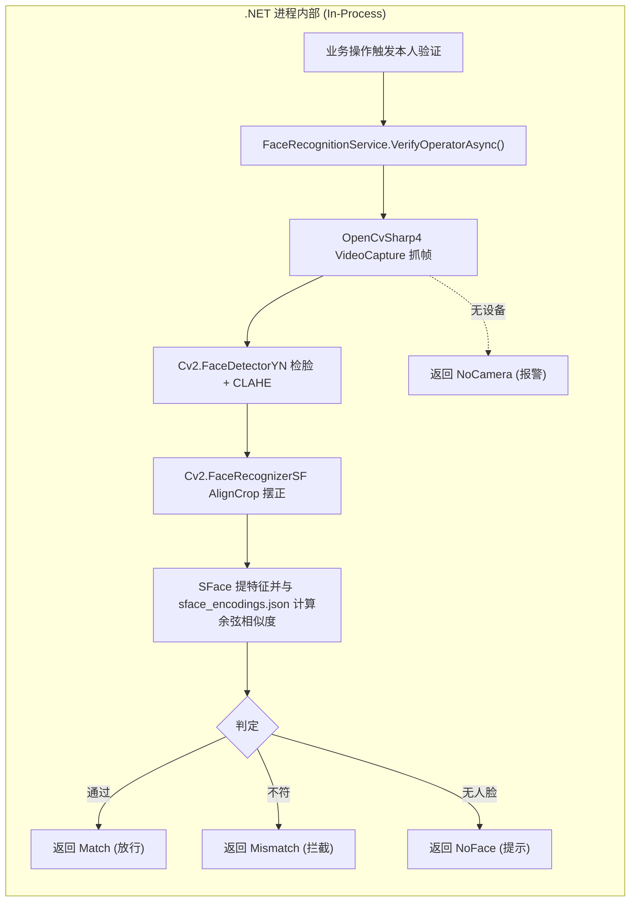

# .NET 原生人脸识别二次验证集成方案文档 (基于 OpenCvSharp4)

本文档面向纯 .NET 桌面端（WPF / WinForms / Avalonia）或 Windows 独立运行程序，提供**零 Python 运行时依赖、完全由 C# 原生运行**的人脸识别验证方案。该方案使用 OpenCV 官方 C# 强类型绑定库 `OpenCvSharp4`，直接在 .NET 进程内加载 `YuNet`（检测）与 `SFace`（识别）ONNX 模型。

---

## 1. 架构设计与优势



### 核心优势
1. **零外部环境依赖**：交付物仅为你的 .NET 应用程序（如单一安装包或便携文件夹），客户机无需配置 Python 解释器、pip 依赖包或虚拟环境。
2. **极低开销与极速响应**：直接在内存中操作 OpenCV C++ 原生底层对象，没有 HTTP 网络传输与跨进程 IPC 损耗，单次人脸特征提取比对通常在 **$10\sim 25\text{ ms}$** 内完成。
3. **无缝 UI 集成**：支持直接在 WPF / WinForms 界面上绘制人脸扫描框、动态倒计时与 Windows Hello 风格的认证动画。

---

## 2. 第一步：将 Python `.pkl` 特征库转为通用 JSON 格式

因为 Python 的 `pickle` 是 Python 独有的序列化机制，.NET 无法直接解析。我们需要将当前已建好的 `temp/sface_encodings.pkl` 导出为通用的 `sface_encodings.json`。

### 导出工具脚本 (`python/export_db_to_json.py`)
```python
import os
import json
import pickle
import numpy as np

pkl_path = r"temp\sface_encodings.pkl"
json_path = r"temp\sface_encodings.json"

with open(pkl_path, "rb") as f:
    db = pickle.load(f)

json_data = {
    "user_name": db.get("user_name", "Master"),
    "count": len(db["sources"]),
    "feature_dim": 128,
    "sources": db["sources"],
    # 将 numpy array 转换为标准 float 列表
    "mean_feature": db["mean_feature"].flatten().tolist(),
    "features": [f.flatten().tolist() for f in db["features"]],
    "created_at": db.get("created_at", "")
}

with open(json_path, "w", encoding="utf-8") as f:
    json.dump(json_data, f, ensure_ascii=False, indent=2)

print(f"✅ 特征库已成功转出为跨平台 JSON 文件: {os.path.abspath(json_path)}")
```
导出的 JSON 文件仅约 35 KB，.NET 原生自带的 `System.Text.Json` 可在一毫秒内完成反序列化。

---

## 3. NuGet 依赖配置

在你的 `.csproj` 中引入以下官方包：

```xml
<ItemGroup>
    <!-- OpenCvSharp 核心 API -->
    <PackageReference Include="OpenCvSharp4" Version="4.10.0.20240616" />
    <!-- 包含 Windows x64 下的所有 C++ 原生动态链接库 (opencv_videoio, dnn 等) -->
    <PackageReference Include="OpenCvSharp4.runtime.win" Version="4.10.0.20240616" />
</ItemGroup>
```

> **注意**：编译发布时，`OpenCvSharp4.runtime.win` 会自动将 `OpenCvSharpExtern.dll` 和 `opencv_videoio_ffmpeg*.dll` 输出到构建目录，无需手动拷贝系统 PATH。

---

## 4. 完整 C# 原生核心实现

以下实现包含：
- 状态结果枚举：`Match`, `Mismatch`, `NoFace`, `NoCamera`。
- 特征底库加载类：`FaceFeatureDatabase`。
- 核心识别服务类：`NativeFaceRecognitionService`（包含 CLAHE 均衡化、5 点五官对齐、双轨余弦相似度匹配、指定超时窗口轮询）。

### 4.1 结果枚举与数据模型 (`FaceVerifyTypes.cs`)

```csharp
using System;
using System.Collections.Generic;
using System.Text.Json.Serialization;

public enum FaceVerifyStatus
{
    Match,          // 认证通过（确认为本人）
    Mismatch,       // 认证失败（检测到人脸，但相似度低于门限）
    NoFace,         // 未检测到人脸（超时未检测到清晰人脸）
    NoCamera        // 硬件错误（无法打开摄像头或被独占）
}

public class FaceVerifyResult
{
    public FaceVerifyStatus Status { get; set; }
    public bool IsSuccess => Status == FaceVerifyStatus.Match;
    public string UserName { get; set; }
    public float Confidence { get; set; }
    public float Threshold { get; set; }
    public string BestSample { get; set; }
    public double ElapsedSeconds { get; set; }
    public int AttemptsCount { get; set; }
    public string Message { get; set; }
}

public class FaceFeatureDbModel
{
    [JsonPropertyName("user_name")]
    public string UserName { get; set; }

    [JsonPropertyName("count")]
    public int Count { get; set; }

    [JsonPropertyName("sources")]
    public List<string> Sources { get; set; }

    [JsonPropertyName("mean_feature")]
    public List<float> MeanFeature { get; set; }

    [JsonPropertyName("features")]
    public List<List<float>> Features { get; set; }
}
```

---

### 4.2 特征库与人脸比对服务 (`NativeFaceRecognitionService.cs`)

```csharp
using System;
using System.Collections.Generic;
using System.Diagnostics;
using System.IO;
using System.Linq;
using System.Text.Json;
using System.Threading;
using System.Threading.Tasks;
using OpenCvSharp;

public class NativeFaceRecognitionService : IDisposable
{
    private FaceDetectorYN _detector;
    private FaceRecognizerSF _recognizer;
    
    // 底库缓存 (均为 128 维归一化浮点数组)
    private string _userName = "Master";
    private float[] _meanFeature;
    private List<float[]> _features = new List<float[]>();
    private List<string> _sources = new List<string>();

    public bool IsInitialized { get; private set; }

    /// <summary>
    /// 初始化模型与特征库
    /// </summary>
    public void Initialize(string yunetModelPath, string sfaceModelPath, string featureJsonPath)
    {
        if (!File.Exists(yunetModelPath)) throw new FileNotFoundException("未找到 YuNet 模型", yunetModelPath);
        if (!File.Exists(sfaceModelPath)) throw new FileNotFoundException("未找到 SFace 模型", sfaceModelPath);
        if (!File.Exists(featureJsonPath)) throw new FileNotFoundException("未找到特征库文件", featureJsonPath);

        // 1. 初始化 OpenCV 原生推理器 (检测器默认输入尺寸 640x480)
        _detector = FaceDetectorYN.Create(yunetModelPath, "", new Size(640, 480), 0.75f, 0.3f);
        _recognizer = FaceRecognizerSF.Create(sfaceModelPath, "");

        // 2. 载入特征底库 JSON
        string jsonText = File.ReadAllText(featureJsonPath);
        var db = JsonSerializer.Deserialize<FaceFeatureDbModel>(jsonText);

        _userName = db.UserName;
        _meanFeature = db.MeanFeature.ToArray();
        _sources = db.Sources;
        _features = db.Features.Select(f => f.ToArray()).ToList();

        IsInitialized = true;
    }

    /// <summary>
    /// CLAHE 亮度自适应直方图均衡化（改善背光/暗部表现）
    /// </summary>
    private Mat EnhanceIllumination(Mat bgr)
    {
        Mat lab = new Mat();
        Cv2.CvtColor(bgr, lab, ColorConversionCodes.BGR2Lab);

        Mat[] channels = Cv2.Split(lab);
        using var clahe = Cv2.CreateCLAHE(clipLimit: 2.0, tileGridSize: new Size(8, 8));
        clahe.Apply(channels[0], channels[0]);

        Mat merged = new Mat();
        Cv2.Merge(channels, merged);
        foreach (var c in channels) c.Dispose();
        lab.Dispose();

        Mat enhanced = new Mat();
        Cv2.CvtColor(merged, enhanced, ColorConversionCodes.Lab2BGR);
        merged.Dispose();
        return enhanced;
    }

    /// <summary>
    /// 计算两个 128 维特征向量的余弦相似度
    /// </summary>
    private float ComputeCosineSimilarity(float[] featA, float[] featB)
    {
        float dot = 0f;
        float normA = 0f;
        float normB = 0f;
        for (int i = 0; i < 128; i++)
        {
            dot += featA[i] * featB[i];
            normA += featA[i] * featA[i];
            normB += featB[i] * featB[i];
        }
        float denom = (float)(Math.Sqrt(normA) * Math.Sqrt(normB));
        return denom > 0f ? (dot / denom) : 0f;
    }

    /// <summary>
    /// 双轨匹配：与底库所有样本取最高分 + 与融合中心向量比对
    /// </summary>
    private (float BestScore, string BestSample) MatchFeature(float[] liveFeature)
    {
        float maxSampleScore = -1f;
        string bestSample = "";

        for (int i = 0; i < _features.Count; i++)
        {
            float s = ComputeCosineSimilarity(liveFeature, _features[i]);
            if (s > maxSampleScore)
            {
                maxSampleScore = s;
                bestSample = _sources[i];
            }
        }

        float centroidScore = ComputeCosineSimilarity(liveFeature, _meanFeature);
        float bestScore = Math.Max(maxSampleScore, centroidScore);

        return (bestScore, bestSample);
    }

    /// <summary>
    /// 调起本机摄像头在指定超时时间内执行本人核验
    /// 策略：在超时窗口内，任意一次比对达标即视为成功，立即快速放行返回。
    /// </summary>
    public async Task<FaceVerifyResult> VerifyOperatorAsync(
        float timeoutSeconds = 3.0f,
        float threshold = 0.38f,
        int cameraId = 0,
        int minFaceHeight = 80,
        CancellationToken cancellationToken = default)
    {
        if (!IsInitialized) throw new InvalidOperationException("服务尚未初始化，请先调用 Initialize()！");

        return await Task.Run(() =>
        {
            var sw = Stopwatch.StartNew();

            using var cap = new VideoCapture(cameraId, VideoCaptureAPIs.DSHOW);
            if (!cap.IsOpened())
            {
                // 回退默认后端尝试
                cap.Open(cameraId);
            }

            if (!cap.IsOpened())
            {
                return new FaceVerifyResult
                {
                    Status = FaceVerifyStatus.NoCamera,
                    UserName = _userName,
                    Threshold = threshold,
                    ElapsedSeconds = sw.Elapsed.TotalSeconds,
                    Message = $"无法打开本地摄像头设备 (ID: {cameraId})，请检查物理连接或驱动状态。"
                };
            }

            // 预热 3 帧
            using var dummy = new Mat();
            for (int i = 0; i < 3; i++) cap.Read(dummy);

            int attempts = 0;
            float highestScore = 0f;
            string bestSampleMatched = null;
            bool faceEverDetected = false;

            using var frame = new Mat();
            while (sw.Elapsed.TotalSeconds < timeoutSeconds && !cancellationToken.IsCancellationRequested)
            {
                if (!cap.Read(frame) || frame.Empty())
                {
                    Thread.Sleep(50);
                    continue;
                }

                attempts++;
                using var enhanced = EnhanceIllumination(frame);

                _detector.InputSize = new Size(enhanced.Width, enhanced.Height);
                using var faces = new Mat();
                _detector.Detect(enhanced, faces);

                if (faces.Rows > 0)
                {
                    // 找到画面中最大的人脸 (x, y, w, h)
                    int bestFaceIdx = 0;
                    float maxArea = 0f;
                    for (int r = 0; r < faces.Rows; r++)
                    {
                        float w = faces.At<float>(r, 2);
                        float h = faces.At<float>(r, 3);
                        float area = w * h;
                        if (area > maxArea)
                        {
                            maxArea = area;
                            bestFaceIdx = r;
                        }
                    }

                    float faceHeight = faces.At<float>(bestFaceIdx, 3);
                    if (faceHeight >= minFaceHeight)
                    {
                        faceEverDetected = true;

                        // 核心：五官关键点仿射对齐摆正
                        using var alignedFace = new Mat();
                        using var faceRow = faces.Row(bestFaceIdx);
                        _recognizer.AlignCrop(enhanced, faceRow, alignedFace);

                        // 提取 128 维特征
                        using var liveFeatMat = new Mat();
                        _recognizer.Feature(alignedFace, liveFeatMat);

                        // 转换为 float[]
                        float[] liveFeat = new float[128];
                        liveFeatMat.GetArray(out liveFeat);

                        var (score, sampleName) = MatchFeature(liveFeat);
                        if (score > highestScore)
                        {
                            highestScore = score;
                            bestSampleMatched = sampleName;
                        }

                        // 任意一次匹配成功策略：立即提前退出并放行！
                        if (score >= threshold)
                        {
                            return new FaceVerifyResult
                            {
                                Status = FaceVerifyStatus.Match,
                                UserName = _userName,
                                Confidence = score,
                                Threshold = threshold,
                                BestSample = sampleName,
                                ElapsedSeconds = Math.Round(sw.Elapsed.TotalSeconds, 2),
                                AttemptsCount = attempts,
                                Message = "身份确认通过，为操作人本人。"
                            };
                        }
                    }
                }

                Thread.Sleep(100); // 间隔 100ms 采样下一帧
            }

            // 超时仍未达标
            double totalCost = Math.Round(sw.Elapsed.TotalSeconds, 2);
            if (!faceEverDetected)
            {
                return new FaceVerifyResult
                {
                    Status = FaceVerifyStatus.NoFace,
                    UserName = _userName,
                    Threshold = threshold,
                    ElapsedSeconds = totalCost,
                    AttemptsCount = attempts,
                    Message = $"在 {timeoutSeconds:F1} 秒内未检测到清晰人脸，请端正坐姿正对摄像头重试。"
                };
            }
            else
            {
                return new FaceVerifyResult
                {
                    Status = FaceVerifyStatus.Mismatch,
                    UserName = _userName,
                    Confidence = highestScore,
                    Threshold = threshold,
                    BestSample = bestSampleMatched,
                    ElapsedSeconds = totalCost,
                    AttemptsCount = attempts,
                    Message = $"人脸特征不匹配 (最高相似度: {highestScore:F3} < 阈值 {threshold:F3})，非注册操作人！"
                };
            }
        }, cancellationToken);
    }

    public void Dispose()
    {
        _detector?.Dispose();
        _recognizer?.Dispose();
    }
}
```

---

## 5. WPF 客户端弹窗调用实战示例

在实际 WPF 桌面程序中，当用户点击“提交转账”、“修改超级权限”或“启动敏感流程”时，展示一个加载提示框：

```csharp
private async void BtnSubmitSensitiveAction_Click(object sender, RoutedEventArgs e)
{
    // 禁用按钮并显示提示
    btnSubmit.IsEnabled = false;
    loadingRing.Visibility = Visibility.Visible;
    txtStatus.Text = "正在进行本人人脸身份确认，请正视摄像头...";

    // 初始化服务单例（实际工程建议在 App.xaml.cs 启动时预初始化）
    using var faceService = new NativeFaceRecognitionService();
    faceService.Initialize(
        yunetModelPath: @"models\face_detection_yunet_2023mar.onnx",
        sfaceModelPath: @"models\face_recognition_sface_2021dec.onnx",
        featureJsonPath: @"models\sface_encodings.json"
    );

    // 允许 3.0 秒窗口期，只要单帧比对 >= 0.380 立即通过
    var result = await faceService.VerifyOperatorAsync(timeoutSeconds: 3.0f, threshold: 0.38f);

    btnSubmit.IsEnabled = true;
    loadingRing.Visibility = Visibility.Collapsed;

    switch (result.Status)
    {
        case FaceVerifyStatus.Match:
            txtStatus.Text = $"验证通过！耗时: {result.ElapsedSeconds}s";
            // 放行：执行后续真正的关键业务逻辑
            ExecuteCoreBusinessLogic();
            break;

        case FaceVerifyStatus.Mismatch:
            MessageBox.Show(result.Message, "安全拦截", MessageBoxButton.OK, MessageBoxImage.Warning);
            break;

        case FaceVerifyStatus.NoFace:
            MessageBox.Show(result.Message, "未见人脸", MessageBoxButton.OK, MessageBoxImage.Information);
            break;

        case FaceVerifyStatus.NoCamera:
            MessageBox.Show(result.Message, "设备异常", MessageBoxButton.OK, MessageBoxImage.Error);
            break;
    }
}
```

---

## 6. 生产工程避坑要点

1. **非托管内存释放 (`IDisposable` 与 `using`)**：
   OpenCvSharp4 内部包含 C++ `cv::Mat` 非托管指针。在每一轮图像处理循环中，所有创建的 `Mat`（如 `frame`, `enhanced`, `faces`, `alignedFace` 等）必须严格置于 `using` 语句块中或显式调用 `.Dispose()`，否则在连续监控数小时后会发生内存泄漏。
2. **初始化时机**：
   `FaceDetectorYN.Create` 与 `FaceRecognizerSF.Create` 会加载 ONNX 计算图，首次加载耗时约 $100\sim 200\text{ ms}$。建议在 .NET 程序启动（如 `App.OnStartup` 或主窗口加载）时作为单例（Singleton）常驻初始化，使用时直接调用 `VerifyOperatorAsync`，实现“即开即验零延迟”。
3. **摄像头被独占与释放**：
   Windows DirectShow 规定同一个 USB 摄像头在同一时刻只能被一个 `VideoCapture` 打开。`VerifyOperatorAsync` 函数在退出时利用 `using var cap` 确保立刻释放摄像头，避免影响用户其他视频会议软件。
