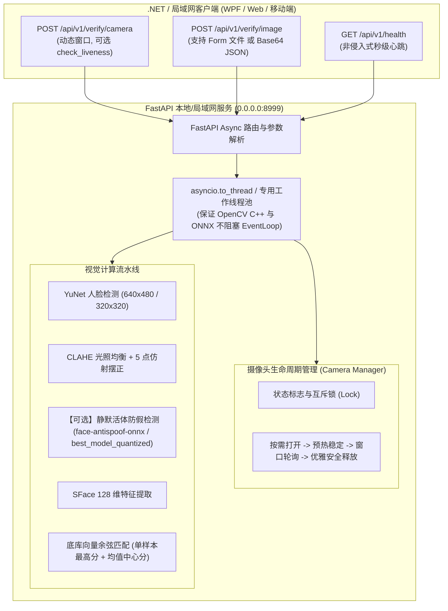

# 局域网人脸识别 API 服务实用落地方案规范

> 本方案针对**个人与局域网（LAN）场景**定制，剔除企业级过度工程化组件（无需繁重权限、无需高并发集群、无需容器编排），核心聚焦于：**零 Bug 高可靠性、摄像头硬件无锁死常驻、异步事件循环不阻塞、活体检测可选插件化、极简脚本一键启动**。

---

## 1. 架构原则与设计定位



### 1.1 核心设计定位
1. **轻量实用**：无 API Key、无 RBAC 权限系统、无 Redis/Celery 依赖，单一 Python 服务即开即用。
2. **硬件高可靠（彻底杜绝死锁与卡顿）**：
   - 绝不在 `/health` 接口中物理启闭摄像头硬件，改为基于服务内存状态的非侵入式健康探测。
   - 所有硬件读取（`cap.read`）与 DNN 计算全部调度至后台线程（`asyncio.to_thread`），彻底释放 asyncio 事件循环，确保服务并发响应不挂死。
   - 摄像头采用严格的异常捕获与 `finally: cap.release()`，保证 Windows DirectShow 驱动不被系统挂死。
3. **活体检测（Anti-Spoofing）可选配置**：
   - 接入现有 `temp/face-antispoof-onnx` 成果（`best_model_quantized.onnx`，约 626KB）。
   - 接口增加 `check_liveness: bool = false` 参数。默认关闭（低延迟极速核验）；开启时进行屏幕翻拍与纸张伪造检测。
4. **双底库格式兼容**：
   - 优先加载 `sface_encodings.json`，同时兼容 `sface_encodings.pkl`。

---

## 2. API 接口定义

服务默认监听 `0.0.0.0:8999`，局域网同网段设备可直接访问 `http://<局域网IP>:8999`。

### 2.1 状态心跳探测 (`GET /api/v1/health`)
- **说明**：无侵入式硬件状态自检，不占用/重置摄像头。
- **响应示例**：
  ```json
  {
    "status": "OK",
    "user_name": "Master",
    "db_samples_count": 36,
    "db_type": "json",
    "yunet_loaded": true,
    "sface_loaded": true,
    "liveness_model_ready": true,
    "server_time": "2026-10-30T16:00:00"
  }
  ```

### 2.2 摄像头动态核验 (`POST /api/v1/verify/camera`)
- **请求体 (JSON)**：
  ```json
  {
    "timeout_seconds": 3.0,
    "threshold": 0.38,
    "camera_id": 0,
    "min_face_height": 80,
    "check_liveness": false,
    "liveness_threshold": 0.5
  }
  ```
  - `check_liveness` (*bool, 默认 false*): 是否启用活体防假检测。
  - `liveness_threshold` (*float, 默认 0.5*): 活体置信度阈值（0.0 ~ 1.0）。
- **响应体 (JSON)**：
  ```json
  {
    "status": "MATCH",
    "matched": true,
    "user_name": "Master",
    "confidence": 0.8842,
    "threshold": 0.380,
    "best_sample": "WIN_20261029_17_09_25_Pro.jpg",
    "liveness_checked": true,
    "liveness_passed": true,
    "liveness_score": 0.962,
    "elapsed_seconds": 0.82,
    "attempts_count": 4,
    "message": "身份核验通过"
  }
  ```
  *状态枚举：`MATCH`（通过）、`MISMATCH`（非本人）、`NO_FACE`（超时无脸）、`NO_CAMERA`（相机无法打开）、`SPOOF_DETECTED`（判定为翻拍/假体）。*

### 2.3 静态图片核验 (`POST /api/v1/verify/image`)
- 支持 `multipart/form-data`（上传文件）与 `application/json`（Base64 字符串）两种输入格式。
- 同样支持 `check_liveness` 参数。

---

## 3. 运行环境与启动设计

系统提供极其简便的启动方式，优先使用本工程 `.venv`，同时向下兼容主机全局开发环境 `C:\Home\Develop\venv`。

### 3.1 启动脚本 (`run_server.bat`)
脚本自动检索：
1. `python\.venv\Scripts\python.exe`
2. `C:\Home\Develop\venv\Scripts\python.exe`
3. 系统 `python.exe`

双击即可拉起服务并显示局域网 IPv4 访问地址。
