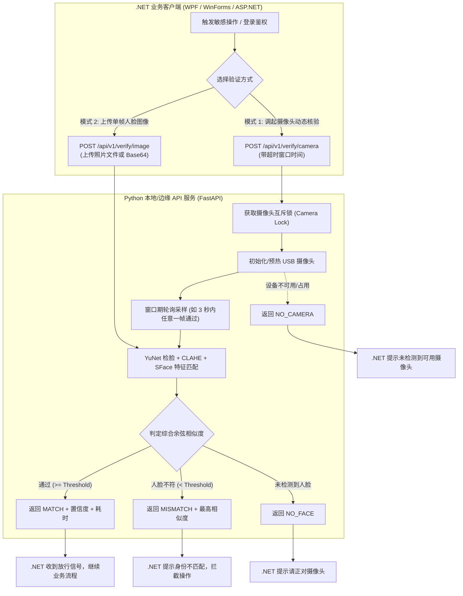

# 人脸识别 Python API 微服务集成方案文档

本文档定义了将 Python 人脸识别（基于 OpenCV YuNet + SFace ONNX 架构）封装为独立 HTTP API 服务的完整方案。该服务作为 .NET 业务系统的**“二次认证 / 关键操作本人确认”**服务，支持接收外部图片比对，或由服务端直接接管本地 USB 摄像头进行窗口期动态鉴权。

---

## 1. 系统架构与交互设计



---

## 2. 状态码与响应协议规范

API 统一返回 HTTP 200，具体业务结果通过 JSON 内的 `status` 字段进行严格枚举标识：

### 2.1 状态枚举表 (`status`)

| 状态枚举值 | 业务含义 | 适用场景 | 说明 |
| :--- | :--- | :--- | :--- |
| **`MATCH`** | **认证通过（确认本人）** | 摄像头窗口内或上传图片中检测到人脸，且与特征库余弦相似度 $\ge \text{threshold}$ | 允许 .NET 业务放行 |
| **`MISMATCH`** | **认证失败（人脸不匹配）** | 检测到清晰人脸，但相似度低于阈值（如外人、非本人） | 阻断操作，记录潜在风险日志 |
| **`NO_FACE`** | **未检测到人脸** | 整个超时时间内摄像头前无人、距离过远、严重侧脸/背光或人脸出框 | 提示操作者正对镜头后重试 |
| **`NO_CAMERA`** | **摄像头不可用** | 本机未插入 USB 摄像头、设备驱动异常或被其他程序独占 | 引导用户检查硬件或切换验证方式 |
| **`INVALID_IMAGE`** | **无效的图像数据** | 仅用于图片上传模式：上传的文件损坏或无法解码 | 要求重新拍摄或上传 |

---

### 2.2 响应 JSON 结构规范

#### 1. 认证通过（`MATCH`）
```json
{
  "status": "MATCH",
  "matched": true,
  "user_name": "Master",
  "confidence": 0.8842,
  "threshold": 0.380,
  "best_sample": "WIN_20261029_17_09_25_Pro.jpg",
  "elapsed_seconds": 1.15,
  "attempts_count": 3,
  "message": "身份认证通过"
}
```

#### 2. 人脸不匹配（`MISMATCH`）
```json
{
  "status": "MISMATCH",
  "matched": false,
  "user_name": "Master",
  "confidence": 0.2415,
  "threshold": 0.380,
  "best_sample": "WIN_20261029_17_08_50_Pro.jpg",
  "elapsed_seconds": 3.02,
  "attempts_count": 7,
  "message": "人脸匹配失败，检测到的人脸与底库不符"
}
```

#### 3. 未检测到人脸（`NO_FACE`）
```json
{
  "status": "NO_FACE",
  "matched": false,
  "user_name": "Master",
  "confidence": 0.0,
  "threshold": 0.380,
  "best_sample": null,
  "elapsed_seconds": 3.01,
  "attempts_count": 8,
  "message": "在指定的 3.0 秒内未检测到清晰人脸，请正对摄像头重试"
}
```

#### 4. 没有摄像头（`NO_CAMERA`）
```json
{
  "status": "NO_CAMERA",
  "matched": false,
  "user_name": "Master",
  "confidence": 0.0,
  "threshold": 0.380,
  "best_sample": null,
  "elapsed_seconds": 0.12,
  "attempts_count": 0,
  "message": "无法打开本地摄像头 (Camera ID: 0)，设备可能未连接或已被其他进程占用"
}
```

---

## 3. 核心 API 接口定义

### 接口 1：本机摄像头动态核验 (推荐模式)
- **URL**: `POST /api/v1/verify/camera`
- **说明**: 服务端自动打开本地连接的 USB 摄像头，在指定超时时间（如 3 秒）内进行高频采样。**只要在窗口期内任意一次比对成功，立即释放摄像头并返回通过（极速响应）**；若超过指定时限仍未匹配，则返回对应错误状态。
- **请求参数 (JSON Body)**:
  ```json
  {
    "timeout_seconds": 3.0,
    "threshold": 0.38,
    "camera_id": 0,
    "strategy": "any_pass",
    "min_face_height": 80
  }
  ```
  - `timeout_seconds` (*float, 默认 3.0*): 最大等待核验时间（秒）。
  - `threshold` (*float, 默认 0.38*): 余弦相似度门限。
  - `strategy` (*string, 默认 "any_pass"*): 
    - `"any_pass"`: 任意单帧成功即通过（适合桌面登录本人验证，体验最快）。
    - `"majority_vote"`: 窗口期内过半通过才放行（适合超高安全级别二次授权）。

---

### 接口 2：静态图片人脸核验
- **URL**: `POST /api/v1/verify/image`
- **说明**: 接收客户端（或前端 WebRTC、外部设备）上传的单张人脸图片进行单帧快速比对。
- **请求方式**: `multipart/form-data`
  - `file`: 图片二进制数据 (`image/jpeg` / `image/png`)
  - `threshold` (*可选, float, 默认 0.38*)

---

### 接口 3：服务健康度与硬件检查
- **URL**: `GET /api/v1/health`
- **响应示例**:
  ```json
  {
    "status": "OK",
    "db_loaded": true,
    "db_samples_count": 36,
    "user_name": "Master",
    "yunet_loaded": true,
    "sface_loaded": true,
    "camera_available": true
  }
  ```

---

## 4. 完整可运行代码实现 (`face_api_server.py`)

使用 FastAPI + Uvicorn 构建，具备**多线程摄像头互斥锁、内存特征预载入、毫秒级快速熔断**机制：

```python
#!/usr/bin/env python3
# -*- coding: utf-8 -*-
"""
人脸识别本地/边缘 HTTP API 服务 (FastAPI + OpenCV ONNX)
提供摄像头动态时间窗口核验与单图静态核验接口。
"""

import os
import sys
import time
import pickle
import asyncio
from typing import Optional
from contextlib import asynccontextmanager

import cv2
import numpy as np
from fastapi import FastAPI, File, UploadFile, Query, Form
from pydantic import BaseModel, Field
import uvicorn

# 强制 UTF-8 输出
if hasattr(sys.stdout, "reconfigure"):
    sys.stdout.reconfigure(encoding="utf-8")

# ==================== 配置区域 ====================
DEFAULT_DB_PATH = os.path.abspath(r"temp\sface_encodings.pkl")
DEFAULT_YUNET_PATH = os.path.abspath(r"temp\face_detection_yunet\face_detection_yunet_2023mar.onnx")
DEFAULT_SFACE_PATH = os.path.abspath(r"temp\face_recognition_sface\face_recognition_sface_2021dec.onnx")
HOST = "127.0.0.1"
PORT = 8999
# =================================================

class GlobalState:
    detector: Optional[cv2.FaceDetectorYN] = None
    recognizer: Optional[cv2.FaceRecognizerSF] = None
    feature_matrix: Optional[np.ndarray] = None
    mean_feature: Optional[np.ndarray] = None
    sources: list = []
    user_name: str = "Master"
    camera_lock: asyncio.Lock = None

state = GlobalState()


def enhance_illumination(bgr_img: np.ndarray) -> np.ndarray:
    """CLAHE 亮度通道均衡化"""
    lab = cv2.cvtColor(bgr_img, cv2.COLOR_BGR2LAB)
    l, a, b = cv2.split(lab)
    clahe = cv2.createCLAHE(clipLimit=2.0, tileGridSize=(8, 8))
    cl = clahe.apply(l)
    return cv2.cvtColor(cv2.merge((cl, a, b)), cv2.COLOR_LAB2BGR)


def match_feature(live_feat_raw: np.ndarray):
    """双轨比对：与底库所有样本取最大相似度 + 与均值特征比对"""
    live_norm = live_feat_raw.astype(np.float32)
    live_norm = live_norm / np.linalg.norm(live_norm)

    # 1. 向量化计算与所有底库样本的余弦相似度
    sims = np.dot(state.feature_matrix, live_norm.T).flatten()
    best_idx = int(np.argmax(sims))
    max_sample_score = float(sims[best_idx])
    best_sample_name = state.sources[best_idx]

    # 2. 与中心向量比对
    centroid_score = float(np.dot(state.mean_feature, live_norm.T)[0, 0])

    best_score = max(max_sample_score, centroid_score)
    return best_score, best_sample_name


@asynccontextmanager
async def lifespan(app: FastAPI):
    # 启动时预载入模型与底库
    state.camera_lock = asyncio.Lock()
    print("[初始化] 正在加载 YuNet 和 SFace 模型...")
    state.detector = cv2.FaceDetectorYN.create(DEFAULT_YUNET_PATH, "", (640, 480), 0.75, 0.3)
    state.recognizer = cv2.FaceRecognizerSF.create(DEFAULT_SFACE_PATH, "")

    if not os.path.exists(DEFAULT_DB_PATH):
        raise FileNotFoundError(f"未找到特征库: {DEFAULT_DB_PATH}，请先执行 build_face_db.py")

    with open(DEFAULT_DB_PATH, "rb") as f:
        db = pickle.load(f)
    state.feature_matrix = db["feature_matrix"]
    state.mean_feature = db["mean_feature"]
    state.sources = db["sources"]
    state.user_name = db.get("user_name", "Master")
    print(f"[就绪] 底库载入成功！用户: {state.user_name}，样本数: {len(state.sources)}")
    yield
    print("[关闭] 释放资源...")


app = FastAPI(title="Face Verification API", version="1.0.0", lifespan=lifespan)


# ==================== 请求与响应模型 ====================
class CameraVerifyRequest(BaseModel):
    timeout_seconds: float = Field(default=3.0, ge=0.5, le=30.0, description="最大允许超时秒数")
    threshold: float = Field(default=0.38, ge=0.1, le=0.9, description="判定余弦相似度阈值")
    camera_id: int = Field(default=0, description="摄像头设备编号")
    strategy: str = Field(default="any_pass", description="验证策略: any_pass (任意一次成功即放行) | majority_vote")
    min_face_height: int = Field(default=80, description="过滤最小人脸高度")


class VerifyResponse(BaseModel):
    status: str = Field(description="状态码: MATCH | MISMATCH | NO_FACE | NO_CAMERA | INVALID_IMAGE")
    matched: bool = Field(description="是否确认是本人")
    user_name: str = Field(description="目标用户名")
    confidence: float = Field(description="实测最高综合余弦相似度")
    threshold: float = Field(description="所使用的阈值")
    best_sample: Optional[str] = Field(default=None, description="命中的底库照片文件名")
    elapsed_seconds: float = Field(description="本次核验总耗时(秒)")
    attempts_count: int = Field(description="采样帧数")
    message: str = Field(description="人读说明")


# ==================== 接口定义 ====================
@app.get("/api/v1/health")
async def health_check():
    """硬件与服务就绪检查"""
    cap = cv2.VideoCapture(0, cv2.CAP_DSHOW)
    cam_ok = cap.isOpened()
    if cap.isOpened():
        cap.release()

    return {
        "status": "OK",
        "user_name": state.user_name,
        "db_samples_count": len(state.sources),
        "camera_available": cam_ok
    }


@app.post("/api/v1/verify/camera", response_model=VerifyResponse)
async def verify_by_camera(req: CameraVerifyRequest):
    """
    通过本机摄像头进行窗口期动态核验。
    只要在 timeout_seconds 内检测到人脸且相似度 >= threshold，立即提前退出并返回 MATCH。
    """
    start_time = time.time()
    
    # 线程锁，防止多个请求同时抢占同一摄像头硬件
    async with state.camera_lock:
        cap = cv2.VideoCapture(req.camera_id, cv2.CAP_DSHOW)
        if not cap.isOpened():
            cap = cv2.VideoCapture(req.camera_id)
        if not cap.isOpened():
            return VerifyResponse(
                status="NO_CAMERA",
                matched=False,
                user_name=state.user_name,
                confidence=0.0,
                threshold=req.threshold,
                best_sample=None,
                elapsed_seconds=round(time.time() - start_time, 2),
                attempts_count=0,
                message="无法打开本地摄像头设备，请检查连接或占用情况"
            )

        attempts = 0
        highest_score = 0.0
        best_matched_sample = None
        face_ever_detected = False

        # 快速预热 3 帧
        for _ in range(3):
            cap.read()

        try:
            while (time.time() - start_time) < req.timeout_seconds:
                ret, frame = cap.read()
                if not ret:
                    await asyncio.sleep(0.05)
                    continue

                attempts += 1
                enhanced = enhance_illumination(frame)
                h, w, _ = frame.shape
                state.detector.setInputSize((w, h))
                _, faces = state.detector.detect(enhanced)

                if faces is not None and len(faces) > 0:
                    face = max(faces, key=lambda f: f[2] * f[3])
                    box_h = int(face[3])
                    if box_h >= req.min_face_height:
                        face_ever_detected = True
                        aligned = state.recognizer.alignCrop(enhanced, face)
                        live_feat = state.recognizer.feature(aligned)

                        score, sample_name = match_feature(live_feat)
                        if score > highest_score:
                            highest_score = score
                            best_matched_sample = sample_name

                        # 任意一帧通过策略：一旦达标，立即跳出返回！
                        if req.strategy == "any_pass" and score >= req.threshold:
                            cost = round(time.time() - start_time, 2)
                            return VerifyResponse(
                                status="MATCH",
                                matched=True,
                                user_name=state.user_name,
                                confidence=round(score, 4),
                                threshold=req.threshold,
                                best_sample=sample_name,
                                elapsed_seconds=cost,
                                attempts_count=attempts,
                                message="身份核验通过"
                            )

                # 间隔 100 毫秒采样下一帧
                await asyncio.sleep(0.1)

        finally:
            cap.release()

        # 超时未触发提前返回时的最终状态判定
        total_cost = round(time.time() - start_time, 2)
        if not face_ever_detected:
            return VerifyResponse(
                status="NO_FACE",
                matched=False,
                user_name=state.user_name,
                confidence=0.0,
                threshold=req.threshold,
                best_sample=None,
                elapsed_seconds=total_cost,
                attempts_count=attempts,
                message=f"在 {req.timeout_seconds:.1f} 秒内未检测到清晰人脸，请正对摄像头"
            )
        else:
            return VerifyResponse(
                status="MISMATCH",
                matched=False,
                user_name=state.user_name,
                confidence=round(highest_score, 4),
                threshold=req.threshold,
                best_sample=best_matched_sample,
                elapsed_seconds=total_cost,
                attempts_count=attempts,
                message=f"人脸相似度不足 (最高 {highest_score:.3f} < 门限 {req.threshold:.3f})，非本人操作"
            )


@app.post("/api/v1/verify/image", response_model=VerifyResponse)
async def verify_by_image(file: UploadFile = File(...), threshold: float = Query(default=0.38)):
    """上传单帧图片进行静态人脸核验"""
    start_time = time.time()
    contents = await file.read()
    nparr = np.frombuffer(contents, np.uint8)
    img = cv2.imdecode(nparr, cv2.IMREAD_COLOR)

    if img is None:
        return VerifyResponse(
            status="INVALID_IMAGE",
            matched=False,
            user_name=state.user_name,
            confidence=0.0,
            threshold=threshold,
            best_sample=None,
            elapsed_seconds=round(time.time() - start_time, 2),
            attempts_count=1,
            message="上传的图像数据无法解码，请提供有效的 JPG 或 PNG 文件"
        )

    enhanced = enhance_illumination(img)
    h, w, _ = img.shape
    state.detector.setInputSize((w, h))
    _, faces = state.detector.detect(enhanced)

    cost = round(time.time() - start_time, 2)
    if faces is None or len(faces) == 0:
        return VerifyResponse(
            status="NO_FACE",
            matched=False,
            user_name=state.user_name,
            confidence=0.0,
            threshold=threshold,
            best_sample=None,
            elapsed_seconds=cost,
            attempts_count=1,
            message="图片中未检测到有效人脸"
        )

    face = max(faces, key=lambda f: f[2] * f[3])
    aligned = state.recognizer.alignCrop(enhanced, face)
    live_feat = state.recognizer.feature(aligned)
    score, sample_name = match_feature(live_feat)

    is_match = score >= threshold
    return VerifyResponse(
        status="MATCH" if is_match else "MISMATCH",
        matched=is_match,
        user_name=state.user_name,
        confidence=round(score, 4),
        threshold=threshold,
        best_sample=sample_name,
        elapsed_seconds=cost,
        attempts_count=1,
        message="身份核验通过" if is_match else "图片人脸与底库不匹配"
    )


if __name__ == "__main__":
    uvicorn.run(app, host=HOST, port=PORT, log_level="info")
```

---

## 5. .NET 客户端调用代码（C# 原生标准封装）

在 .NET 项目中，编写一个轻量级的 `FaceVerifyClient` 服务类，即可轻松在任何操作前插入验证：

```csharp
using System;
using System.Net.Http;
using System.Net.Http.Json;
using System.Text.Json;
using System.Text.Json.Serialization;
using System.Threading.Tasks;

public enum FaceVerifyStatus
{
    MATCH,          // 认证通过
    MISMATCH,       // 识别失败（人脸不符）
    NO_FACE,        // 未检测到人脸
    NO_CAMERA,      // 摄像头无法打开/未接入
    INVALID_IMAGE   // 上传的图像数据无效
}

public class FaceVerifyResult
{
    [JsonPropertyName("status")]
    public string StatusRaw { get; set; }

    [JsonIgnore]
    public FaceVerifyStatus Status => Enum.TryParse<FaceVerifyStatus>(StatusRaw, true, out var s) 
        ? s : FaceVerifyStatus.MISMATCH;

    [JsonPropertyName("matched")]
    public bool Matched { get; set; }

    [JsonPropertyName("user_name")]
    public string UserName { get; set; }

    [JsonPropertyName("confidence")]
    public float Confidence { get; set; }

    [JsonPropertyName("threshold")]
    public float Threshold { get; set; }

    [JsonPropertyName("best_sample")]
    public string BestSample { get; set; }

    [JsonPropertyName("elapsed_seconds")]
    public float ElapsedSeconds { get; set; }

    [JsonPropertyName("message")]
    public string Message { get; set; }
}

public class FaceAuthService
{
    private static readonly HttpClient _httpClient = new HttpClient
    {
        BaseAddress = new Uri("http://127.0.0.1:8999"),
        Timeout = TimeSpan.FromSeconds(10) // 整体 HTTP 超时略长于摄像头核验超时
    };

    /// <summary>
    /// 调起摄像头进行时间窗口核验（例如 3 秒内任意一次成功即算通过）
    /// </summary>
    public async Task<FaceVerifyResult> VerifyOperatorAsync(float timeoutSeconds = 3.0f, float threshold = 0.38f)
    {
        var payload = new
        {
            timeout_seconds = timeoutSeconds,
            threshold = threshold,
            camera_id = 0,
            strategy = "any_pass"
        };

        try
        {
            var response = await _httpClient.PostAsJsonAsync("/api/v1/verify/camera", payload);
            response.EnsureSuccessStatusCode();

            var result = await response.Content.ReadFromJsonAsync<FaceVerifyResult>();
            return result;
        }
        catch (HttpRequestException ex)
        {
            return new FaceVerifyResult
            {
                StatusRaw = nameof(FaceVerifyStatus.NO_CAMERA),
                Matched = false,
                Message = $"无法连接到本地人脸识别服务: {ex.Message}"
            };
        }
    }
}
```

### 业务使用示例（如 WPF 按钮点击事件）：
```csharp
private async void OnSensitiveActionClick(object sender, RoutedEventArgs e)
{
    txtStatus.Text = "请正视摄像头进行本人验证...";
    btnSubmit.IsEnabled = false;

    var authService = new FaceAuthService();
    // 允许 3 秒时间窗口，任意一帧匹配成功即放行
    var result = await authService.VerifyOperatorAsync(timeoutSeconds: 3.0f, threshold: 0.38f);

    btnSubmit.IsEnabled = true;

    switch (result.Status)
    {
        case FaceVerifyStatus.MATCH:
            MessageBox.Show($"验证通过！操作人: {result.UserName} (相似度: {result.Confidence:P1})", "成功");
            ExecuteCriticalOperation();
            break;

        case FaceVerifyStatus.MISMATCH:
            MessageBox.Show($"验证失败：当前人员非注册操作人！(相似度: {result.Confidence:P1})", "警告", MessageBoxButton.OK, MessageBoxImage.Warning);
            break;

        case FaceVerifyStatus.NO_FACE:
            MessageBox.Show("未在规定时间内检测到人脸，请端正坐姿正对摄像头重试。", "提示");
            break;

        case FaceVerifyStatus.NO_CAMERA:
            MessageBox.Show(result.Message, "硬件错误", MessageBoxButton.OK, MessageBoxImage.Error);
            break;
    }
}
```

---

## 6. Windows 开机自启与静默常驻配置

可以通过 Windows 原生计划任务（Task Scheduler）或使用 NSSM 将其包装为静默 Windows 服务：

```powershell
# 快捷启动命令（测试运行）：
& "C:\Home\Develop\venv\Scripts\python.exe" python\face_api_server.py
```
服务默认监听 `127.0.0.1:8999`，仅允许本机回环访问，确保通信安全无外网暴露风险。
